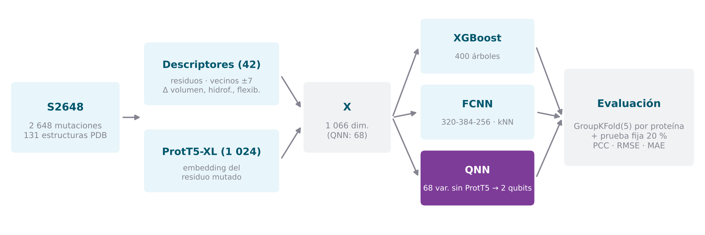
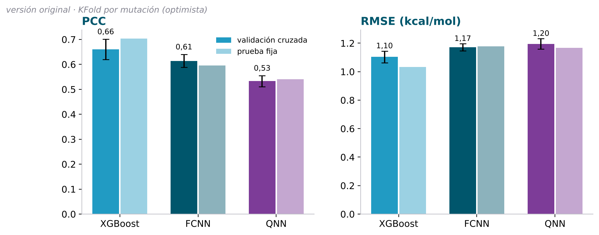
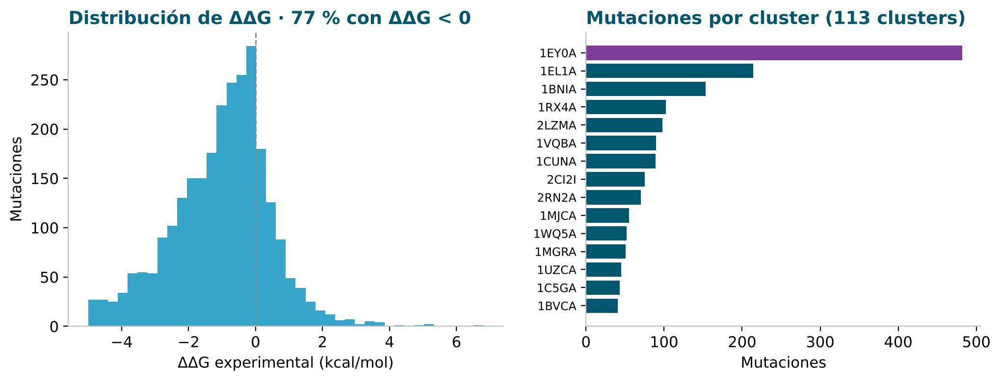
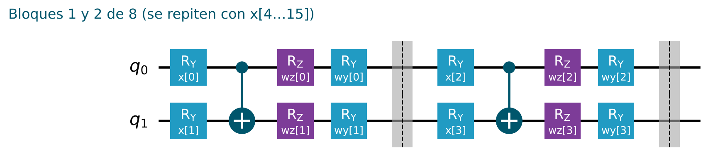

<div align="center">

# Modelos clásicos y cuánticos para la predicción de la estabilidad proteica

**Un enfoque comparativo: XGBoost, red neuronal densa y red neuronal cuántica híbrida para predecir el ΔΔG de mutaciones puntuales**

Marco Antonio Roca Rodríguez · Director: Óscar Fernández Mora
Trabajo Fin de Máster · Máster Universitario en Inteligencia Artificial · Universidad Alfonso X el Sabio (UAX) · 2025

[](https://colab.research.google.com/github/marrocrod/TFM_UAX/blob/main/notebook/estabilidad_proteica.ipynb)
[](https://www.python.org/)
[](https://xgboost.readthedocs.io/)
[](https://www.tensorflow.org/)
[](https://www.ibm.com/quantum/qiskit)
[](https://github.com/agemagician/ProtTrans)
[](LICENSE)

[**Memoria**](docs/Memoria.pdf) · [**Notebook**](notebook/estabilidad_proteica.ipynb) · [**Metodología**](docs/metodologia.md) · [**Correcciones**](docs/correcciones.md) · [**Resultados**](results/) · [**Datos**](data/)

<br>



</div>

---

## La pregunta

Una sola mutación puede desestabilizar una proteína y alterar su función. Predecir ese efecto, el cambio de energía libre de plegamiento **ΔΔG**, es clave en ingeniería de proteínas y en el estudio de enfermedades genéticas.

Este trabajo compara tres enfoques sobre el conjunto de referencia **S2648**, con las mismas mutaciones y el mismo protocolo de evaluación:

| Modelo | Tipo | Idea |
|---|---|---|
| **XGBoost** | Árboles de decisión potenciados | Referencia clásica fuerte para datos tabulares |
| **FCNN** | Red neuronal densa (Keras) | Red profunda con una meta-característica kNN y una pérdida que optimiza a la vez el error y la correlación |
| **QNN** | Red híbrida cuántico-clásica (Qiskit + PyTorch) | Circuito variacional de 2 qubits con recarga de datos, combinado con una rama clásica |

> [!IMPORTANT]
> **Versión corregida.** La versión original del notebook tenía errores metodológicos que hacían las métricas optimistas: particiones por mutación en lugar de por proteína, el embedding de ProtT5 desplazado una posición, posiciones del PDB usadas como índices de la secuencia y parada temprana de la QNN sobre el conjunto de prueba, entre otros. Están todos corregidos y documentados en [`docs/correcciones.md`](docs/correcciones.md).
>
> Las cifras de la versión corregida se publicarán cuando termine su ejecución completa. Mientras tanto, abajo se muestran las de la versión original, marcadas como tales.

## Resultados

<p align="center"></p>

<!-- RESULTADOS:INICIO -->

**Versión corregida**: pendiente de la ejecución completa. La tabla se rellena con `python scripts/actualizar_resultados.py`.

<!-- RESULTADOS:FIN -->

**Versión original**: validación cruzada en 5 particiones por mutación y prueba fija del 20 %.

| Modelo | PCC (CV) | MSE (CV) | MAE (CV) | PCC (prueba) | RMSE (prueba) |
|---|---:|---:|---:|---:|---:|
| XGBoost | 0,660 ± 0,041 | 1,220 ± 0,090 | 0,840 ± 0,033 | 0,703 | 1,034 |
| FCNN | 0,614 ± 0,026 | 1,372 ± 0,058 | 0,880 ± 0,019 | 0,596 | 1,178 |
| QNN | 0,533 ± 0,022 | 1,430 ± 0,088 | 0,970 ± 0,030 | 0,540 | 1,167 |

<sub>Son las cifras publicadas en la [memoria](docs/Memoria.pdf) (Tablas 1–3). Son optimistas: mutaciones de la misma proteína aparecían a la vez en entrenamiento y en prueba, y la QNN usaba la prueba para su parada temprana. Detalle en [`results/version_original.json`](results/version_original.json).</sub>

En la versión original, el orden de los modelos era **XGBoost > FCNN > QNN**. El modelo cuántico, con solo 2 qubits y 32 parámetros en el circuito, quedaba por debajo de las referencias clásicas. La versión corregida permitirá comprobar si ese orden se mantiene cuando los tres modelos se evalúan en igualdad de condiciones y sobre proteínas no vistas.

## Datos

<p align="center"></p>

**S2648** (Dehouck *et al.*, 2009) reúne 2 648 mutaciones puntuales de 131 estructuras del PDB, agrupadas en 113 *clusters* de proteínas homólogas, con su ΔΔG experimental. Las mutaciones se reparten de forma muy desigual: una sola proteína, 1EY0, aporta 482. Esa es la razón por la que la evaluación tiene que **agrupar por proteína**.

## Características

**XGBoost y FCNN** describen cada mutación con **1 066 variables**:

| Bloque | Dim. | Contenido |
|---|---:|---|
| Residuos y posición | 4 | Residuo original y mutado; posición absoluta y relativa en la cadena |
| Entorno en la secuencia | 34 | Los 14 vecinos a ±7 posiciones y la composición de aminoácidos de esa ventana |
| Fisicoquímica | 3 | Δ volumen, Δ hidrofobicidad y Δ flexibilidad |
| Tipo de mutación | 1 | Identificador del par original → mutado |
| **ProtT5-XL** | **1 024** | Embedding del residuo mutado, calculado sobre la secuencia completa de la cadena |

**La QNN** usa, por diseño, un vector más ligero de **68 variables sin ProtT5**, para que la entrada al circuito sea pequeña. Contiene:
- las propiedades básicas de la mutación;
- la codificación *one-hot* del residuo original y del mutado (20 + 20);
- la posición normalizada;
- la composición de la ventana ±7.

`QNN_USE_PROTT5 = True` le añade el embedding.

Las posiciones de S2648 siguen la numeración del PDB. Por eso cada mutación se localiza en la secuencia a partir de la propia estructura, comprobando que el residuo coincide.

## La red neuronal cuántica

<p align="center"></p>

- **Entrada al circuito.** Las 68 variables de la QNN se reducen por PCA a 16 componentes, que entran por pares como ángulos $R_Y$ en **8 bloques de recarga de datos**.
- **Bloques.** Cada bloque entrelaza los dos qubits con una CNOT y aplica rotaciones entrenables $R_Z$ y $R_Y$. En total son 32 parámetros.
- **Medición.** Se miden $\langle Z_0\rangle$, $\langle Z_1\rangle$ y $\langle Z_0 Z_1\rangle$.
- **Rama clásica.** Las tres medidas se combinan con las 16 componentes y la meta-característica kNN en un MLP `→ 64 → 64 → 1`.

## Protocolo de evaluación

- **Validación cruzada agrupada por proteína:** `GroupKFold(5)` sobre los *clusters* de S2648.
- **Prueba fija:** el 20 % de los *clusters*, que el modelo no ve durante el entrenamiento.
- **Sin fugas de información:** escalado, PCA, vecinos kNN y parada temprana se ajustan solo con la parte de entrenamiento de cada partición.
- **Métricas:** correlación de Pearson (PCC), RMSE y MAE en kcal/mol.

## Estructura del repositorio

```text
TFM_UAX/
├── notebook/
│   ├── estabilidad_proteica.ipynb       # versión corregida, documentada paso a paso
│   └── version_original/
│       └── Notebook_final.ipynb         # versión original, conservada como referencia
├── data/
│   └── s2648.csv                        # conjunto S2648
├── results/
│   ├── version_original.json            # métricas de la versión original
│   └── ...                              # resultados de la versión corregida (al ejecutarla)
├── docs/
│   ├── Memoria.pdf                      # memoria del TFM
│   ├── metodologia.md                   # descripción técnica completa del pipeline
│   ├── correcciones.md                  # qué estaba mal y cómo se ha corregido
│   └── figures/                         # figuras de este README
├── scripts/
│   ├── actualizar_resultados.py         # resultados del notebook → tablas y README
│   └── generar_figuras.py               # figuras de docs/figures/
├── requirements.txt
├── CITATION.cff
└── LICENSE
```

## Cómo ejecutarlo

**En Google Colab (recomendado).**
1. Pulsa el botón *Open in Colab*.
2. Activa la GPU en *Entorno de ejecución → Cambiar tipo de entorno*.
3. Ejecuta todas las celdas.

La primera celda clona el repositorio e instala lo que falte. Antes de la ejecución completa, conviene hacer una prueba rápida con `RUN_MODE = "smoke"`.

**En local.**

```bash
git clone https://github.com/marrocrod/TFM_UAX.git
cd TFM_UAX
python -m venv .venv && source .venv/bin/activate     # Windows: .venv\Scripts\activate
pip install -r requirements.txt
jupyter lab notebook/estabilidad_proteica.ipynb
```

**Después de una ejecución completa**, copia en `results/` los ficheros que genera el notebook y ejecuta:

```bash
python scripts/actualizar_resultados.py    # tablas CSV, tabla del README y figuras
```

Las estructuras del PDB y los embeddings de ProtT5 se descargan y calculan una sola vez y se guardan en `cache/`. ProtT5-XL pesa varios GB y necesita GPU para ir a una velocidad razonable. La QNN es la parte más lenta, porque su simulación con `EstimatorQNN` tarda del orden de minutos por época.

## Próximos pasos

- **Métricas.**
  - Codificación química de los residuos.
  - Usar el pH, la temperatura y la estructura 3D: accesibilidad al disolvente y contactos.
  - Aumento de datos por antisimetría del ΔΔG.
  - Ajuste de hiperparámetros con el protocolo agrupado.
- **Rendimiento.** Simular el circuito de 2 qubits directamente en PyTorch, que es exacto y mucho más rápido que `EstimatorQNN`.
- **Continuación.** La línea de este trabajo sigue en el TFM del Máster en Computación Cuántica: [*Red neuronal cuántica híbrida para la predicción de estructura de proteínas*](https://github.com/marrocrod/qnn-protein_structure-prediction).

## Cita

```bibtex
@mastersthesis{roca2025stability,
  author = {Roca Rodríguez, Marco Antonio},
  title  = {Modelos clásicos y cuánticos para la predicción de estabilidad proteica:
            un enfoque comparativo},
  school = {Universidad Alfonso X el Sabio (UAX)},
  type   = {Trabajo Fin de Máster, Máster Universitario en Inteligencia Artificial},
  year   = {2025},
  url    = {https://github.com/marrocrod/TFM_UAX}
}
```

## Licencia

El código se distribuye bajo licencia [MIT](LICENSE). El conjunto S2648, ProtT5 y las estructuras del PDB mantienen sus propias condiciones de uso.
