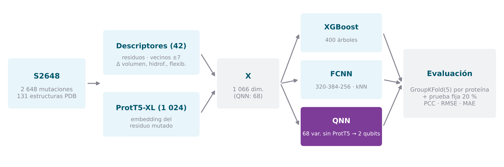
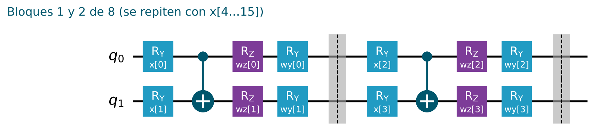

# Metodología

Descripción técnica del pipeline **tal y como está implementado** en [`notebook/estabilidad_proteica.ipynb`](../notebook/estabilidad_proteica.ipynb). Cada sección indica la parte del notebook donde vive el código.

<p align="center"></p>

---

## 1. Problema

Dada una proteína con estructura conocida y una mutación puntual (un aminoácido cambiado por otro), predecir el cambio de energía libre de plegamiento:

$$\Delta\Delta G = \Delta G_{\text{mutante}} - \Delta G_{\text{original}} \quad [\text{kcal/mol}]$$

Es una **regresión** sobre una variable continua.

## 2. Datos (Parte II)

| Elemento | Detalle |
|---|---|
| Conjunto | **S2648** (Dehouck *et al.*, 2009): 2 648 mutaciones, 131 estructuras, 113 *clusters* de homología (`CLID`) |
| Formato de la mutación | residuo original, posición con la numeración del PDB (con código de inserción opcional) y residuo mutado, p. ej. `L27CN` |
| Estructuras | se descargan del PDB (formato PDB y, si no existe, mmCIF) y se guardan en `cache/pdb/` |
| Secuencia | residuos estándar de la cadena, en orden, del primer modelo de la estructura |
| Localización | mapa *(número de residuo, código de inserción) → índice en la secuencia* |
| Control | se descarta toda mutación cuyo residuo en la secuencia no coincide con el residuo original de S2648 |

## 3. Características (Parte III)

Hay dos matrices con **las mismas filas**:
- **`X` (1 066):** descriptores y ProtT5, para XGBoost y la FCNN.
- **`X_qnn` (68):** el vector propio de la QNN, sin ProtT5.

### Descriptores (42)

| Variables | Nº | Definición |
|---|---:|---|
| `wt_code`, `mut_code` | 2 | `ord(letra) − 65` del residuo original y del mutado |
| `seq_index`, `rel_position` | 2 | índice $k$ en la secuencia y $k/L$ |
| `neighbour_±1 … ±7` | 14 | `ord(letra) − 65` de cada vecino; −1 si queda fuera de la cadena |
| `count_A … count_Y` | 20 | número de veces que aparece cada aminoácido estándar en la ventana ±7 |
| `d_volume` | 1 | volumen del mutado − volumen del original (ų) |
| `d_hydrophobicity` | 1 | diferencia de hidrofobicidad |
| `d_flexibility` | 1 | diferencia de flexibilidad (número de rotámeros) |
| `mutation_type` | 1 | identificador 1 – 380 del par ordenado (original, mutado) |

### Embedding de ProtT5 (1 024)

- **Modelo:** ProtT5-XL entrenado sobre BFD (`Rostlab/prot_t5_xl_bfd`), solo el codificador, en media precisión en GPU.
- **Entrada:** la secuencia de la cadena con los aminoácidos separados por espacios (U, Z, O y B se sustituyen por X). La salida tiene $L + 1$ vectores, uno por residuo más `</s>`.
- **Vector usado:** la fila $k$, la del residuo mutado.
- **Caché:** cada cadena se procesa una vez y su matriz se guarda en `cache/prott5/<PDB>_<cadena>.npy`.

### Vector de la QNN (68)

Se mantiene el diseño de la memoria: sin ProtT5, para que la entrada al circuito sea pequeña.

| Variables | Nº | Definición |
|---|---:|---|
| Básicas | 7 | `ord − 65` del residuo original y del mutado; índice $k$; Δ volumen, Δ hidrofobicidad, Δ flexibilidad; tipo de mutación |
| *One-hot* | 40 | residuo original (20) y residuo mutado (20) |
| Posición | 1 | $k/(L-1)$ |
| Composición | 20 | aminoácidos estándar en la ventana ±7 |

Con `QNN_USE_PROTT5 = True` se le añaden las 1 024 dimensiones de ProtT5.

## 4. Protocolo de evaluación (Parte IV)

| Elemento | Detalle |
|---|---|
| Validación cruzada | `GroupKFold(5)` por `CLID` |
| Prueba fija | `GroupShuffleSplit(test_size=0,2, random_state=42)` por `CLID` |
| Interfaz | cada modelo es una función `fit_predict(X_tr, y_tr, g_tr, X_te)` que hace todo su preprocesado con `X_tr` |
| Métricas | PCC (Pearson), RMSE, MSE y MAE; media ± desviación entre particiones y valor en la prueba fija |

Agrupar por *cluster* evita que mutaciones de la misma proteína, o de una homóloga, caigan a la vez en entrenamiento y en evaluación. Así se mide la capacidad de **generalizar a proteínas nuevas**, que es el caso de uso real.

**Meta-característica kNN** (`knn_oof_feature`, la usan la FCNN y la QNN):

- **En entrenamiento:** predicción de un regresor kNN ponderado por distancia, calculada *out-of-fold* con `GroupKFold` dentro del propio entrenamiento.
- **En evaluación:** un kNN ajustado con todo el entrenamiento.

## 5. XGBoost (Parte V)

| Parámetro | Valor |
|---|---|
| Árboles / profundidad / tasa | 400 / 5 / 0,05 |
| `subsample` / `colsample_bytree` | 1,0 / 1,0 |
| Escalado | ninguno: los árboles no dependen de la escala |

## 6. FCNN (Parte VI)

```
[X estandarizada ‖ kNN estandarizado] (1 067) → LayerNorm
  → Dense 320 · swish · Dropout 0,4
  → Dense 384 · swish · Dropout 0,4
  → Dense 256 · swish
  → Dense 1
```

| Elemento | Valor |
|---|---|
| Objetivo | $y$ estandarizada con el entrenamiento; la predicción se devuelve a kcal/mol |
| Pérdida | $0{,}50\,\mathrm{MSE} + 0{,}45\,(1 - r^2) + 0{,}05\,(\sigma_{\hat y} - 1)^2$ |
| Optimizador | Adam (`clipnorm` 1) con *Cosine Decay Restarts* (5·10⁻⁴, primer ciclo de 400 pasos, ×1,5 y ×0,9) |
| Regularización | L2 1·10⁻⁵ · *dropout* 0,4 |
| Parada | temprana sobre un 10 % del entrenamiento agrupado por proteína (paciencia 16, máx. 250 épocas, lotes de 128) |
| Ensemble | media de 3 semillas (42, 7 y 1337) |
| kNN | 28 vecinos |

El término $(1 - r^2)$ empuja a la red a **ordenar bien** las mutaciones, y el término de desviación evita que las predicciones se concentren alrededor de la media.

## 7. QNN (Parte VII)

<p align="center"></p>

### Entrada

`X_qnn` (68 variables) estandarizada y reducida a 16 componentes por PCA, con las dos transformaciones ajustadas con el entrenamiento. Esas 16 componentes forman la entrada cuántica (sin escalado angular adicional) y, junto con el kNN de 15 vecinos, la rama clásica.

### Circuito

Para $b = 0,\dots,7$:

$$R_Y(x_{2b}) \otimes R_Y(x_{2b+1}) \;\rightarrow\; \mathrm{CNOT}_{0\to1} \;\rightarrow\; \big[R_Y(w^y_{2b})R_Z(w^z_{2b})\big] \otimes \big[R_Y(w^y_{2b+1})R_Z(w^z_{2b+1})\big]$$

| Elemento | Valor |
|---|---|
| Qubits / bloques | 2 / 8 (*data re-uploading*: las 16 componentes entran por pares) |
| Parámetros del circuito | 32 ($w^z$ y $w^y$, 16 cada uno) |
| Observables | $\langle Z_0\rangle$, $\langle Z_1\rangle$ y $\langle Z_0 Z_1\rangle$, valores esperados exactos (`StatevectorEstimator`) |
| Integración | `EstimatorQNN` + `TorchConnector`; gradiente solo respecto a los pesos |

### Red híbrida

```
[⟨Z₀⟩, ⟨Z₁⟩, ⟨Z₀Z₁⟩] ‖ [PCA 16 ‖ kNN] (20) → Linear 64 · GELU · Dropout 0,2
  → Linear 64 · GELU · Dropout 0,1 → Linear 1
```

| Elemento | Valor |
|---|---|
| Pérdida | $0{,}55\,\mathrm{Huber}(\delta{=}1) + 0{,}40\,(1 - r^2) + 0{,}05\,(\sigma_{\hat y} - 1)^2$ sobre $y$ estandarizada |
| Optimizador | AdamW (2·10⁻³, *weight decay* 10⁻³), recorte del gradiente a 1, `ReduceLROnPlateau` (×0,5, paciencia 3) |
| Parada | temprana sobre un 10 % del entrenamiento agrupado por proteína (paciencia 5) |
| Épocas | 12 por partición de la validación cruzada, 18 en la prueba fija |
| Lotes | 64 |

## 8. Reproducibilidad

- **Semilla:** 42, fijada en Python, NumPy, TensorFlow y PyTorch. En la FCNN, además, una semilla por miembro del ensemble.
- **Modo `smoke`:** usa 12 *clusters* al azar, 1–3 épocas y PCA de 4 componentes, y recorre todo el pipeline en minutos.
- **Orden de carga:** PyTorch carga su compilador antes que TensorFlow, para evitar un conflicto entre las LLVM de ambas librerías.

## 9. Limitaciones conocidas

- **Codificación de residuos.** `ord(letra) − 65` es un número sin significado químico.
- **Variables sin usar.** No se usan el pH, la temperatura ni descriptores de la estructura 3D.
- **Velocidad de la QNN.** `EstimatorQNN` evalúa el circuito muestra a muestra y tarda del orden de 20 minutos por época en Colab.
- **Tamaño de los datos.** S2648 es pequeño y está desequilibrado: 1EY0 aporta el 18 % de las mutaciones.

Son los puntos de partida de la fase de mejora.
