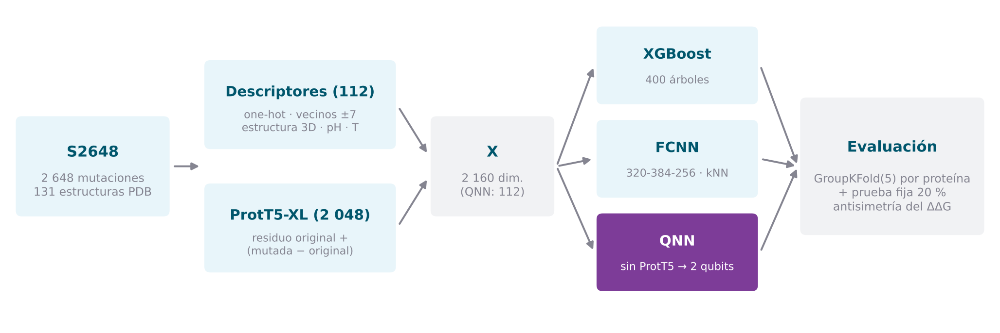
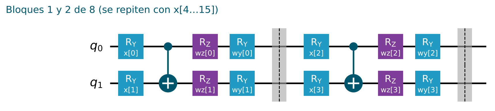

# Metodología

Descripción técnica del pipeline **tal y como está implementado** en [`notebook/estabilidad_proteica.ipynb`](../notebook/estabilidad_proteica.ipynb). Cada sección indica la parte del notebook donde vive el código.

<p align="center"></p>

---

## 1. Problema

Dada una proteína con estructura conocida y una mutación puntual (un aminoácido cambiado por otro), predecir el cambio de energía libre de plegamiento:

$$\Delta\Delta G = \Delta G_{\text{mutante}} - \Delta G_{\text{original}} \quad [\text{kcal/mol}]$$

Es una **regresión** sobre una variable continua.

## 2. Datos (Parte II)

| Elemento | Detalle |
|---|---|
| Conjunto | **S2648** (Dehouck *et al.*, 2009): 2 648 mutaciones, 131 estructuras, 113 *clusters* de homología (`CLID`) |
| Formato de la mutación | residuo original, posición con la numeración del PDB (con código de inserción opcional) y residuo mutado, p. ej. `L27CN` |
| Estructuras | se descargan del PDB (formato PDB y, si no existe, mmCIF) y se guardan en `cache/pdb/` |
| Secuencia | residuos estándar de la cadena, en orden, del primer modelo de la estructura |
| Localización | mapa *(número de residuo, código de inserción) → índice en la secuencia* |
| Control | se descarta toda mutación cuyo residuo en la secuencia no coincide con el residuo original de S2648 |
| Perfil estructural | accesibilidad, contactos y profundidad de cada residuo, calculados sobre la cadena aislada (sección 3) |

## 3. Características (Parte III)

Hay cuatro matrices con **las mismas filas**:
- **`X` y `X_REV` (2 160):** todas las variables, para XGBoost y la FCNN, en sentido directo (original → mutado) e inverso (mutado → original).
- **`X_QNN` y `X_QNN_REV` (112):** lo mismo sin ProtT5, para la QNN.

Las matrices inversas se usan para la antisimetría (sección 4).

### Descriptores de la mutación (106)

| Variables | Nº | Definición |
|---|---:|---|
| `from_A … from_Y` | 20 | *one-hot* del residuo de partida |
| `to_A … to_Y` | 20 | *one-hot* del residuo de llegada |
| `rel_position` | 1 | $k/(L-1)$ |
| `neigh±1 … ±7` × (`vol`, `hyd`, `flex`) | 42 | volumen, hidrofobicidad y flexibilidad de cada vecino; ceros si queda fuera de la cadena |
| `count_A … count_Y` | 20 | número de veces que aparece cada aminoácido estándar en la ventana ±7 |
| `d_volume`, `d_hydrophobicity`, `d_flexibility` | 3 | propiedad del residuo de llegada − la del de partida |

En la mutación inversa se intercambian los dos *one-hot* y cambian de signo las tres diferencias. El resto es igual.

### Estructura 3D (4)

Se calcula sobre la cadena aislada, solo con residuos estándar, sin hidrógenos ni ligandos.

| Variable | Definición |
|---|---|
| `rsa` | área accesible al disolvente (Shrake-Rupley, Biopython) dividida entre el máximo teórico del aminoácido (Tien *et al.*, 2013), acotada a 1 |
| `contacts_8`, `contacts_12` | número de Cα a menos de 8 y 12 Å del Cα del residuo |
| `depth` | distancia del Cα al centro de la cadena, dividida entre el radio de giro |

### Condiciones del experimento (2)

`pH` y `T` de S2648.

La estructura y las condiciones son las mismas en los dos sentidos: para la mutación inversa se usan las de la proteína original, lo que es una aproximación.

### Embeddings de ProtT5 (2 048)

- **Modelo:** ProtT5-XL entrenado sobre BFD (`Rostlab/prot_t5_xl_bfd`), solo el codificador, en media precisión en GPU.
- **Entrada:** la secuencia de la cadena con los aminoácidos separados por espacios. La salida tiene $L + 1$ vectores, uno por residuo más `</s>`.
- **Vectores usados**, los dos en la posición mutada $k$:
  - $e_{wt}$ (1 024): con la secuencia original;
  - $e_{mut} - e_{wt}$ (1 024): diferencia con el embedding de la secuencia mutada.
- **Mutación inversa:** $e_{mut}$ pasa a ser el embedding de partida y la diferencia cambia de signo.
- **Caché:** los vectores de cada cadena se guardan en `cache/prott5/<PDB>_<cadena>.npz`.

## 4. Protocolo de evaluación (Parte IV)

| Elemento | Detalle |
|---|---|
| Validación cruzada | `GroupKFold(5)` por `CLID` |
| Prueba fija | `GroupShuffleSplit(test_size=0,2, random_state=42)` por `CLID` |
| Interfaz | cada modelo es una función `fit_predict(X_tr, y_tr, g_tr, X_te)` que hace todo su preprocesado con `X_tr` |
| Antisimetría en el entrenamiento | a cada mutación de entrenamiento se le añade su inversa con $-\Delta\Delta G$ (`AUGMENT_ANTISYMMETRY`) |
| Antisimetría en la predicción | $\hat y = \tfrac12\,[f(\text{directa}) - f(\text{inversa})]$ (`ANTISYMMETRIC_PREDICTION`) |
| Métricas | PCC (Pearson), RMSE, MSE y MAE; media ± desviación entre particiones y valor en la prueba fija |

Agrupar por *cluster* evita que mutaciones de la misma proteína, o de una homóloga, caigan a la vez en entrenamiento y en evaluación. Así se mide la capacidad de **generalizar a proteínas nuevas**, que es el caso de uso real.

**Meta-característica kNN** (`knn_oof_feature`, la usan la FCNN y la QNN):

- **En entrenamiento:** predicción de un regresor kNN ponderado por distancia, calculada *out-of-fold* con `GroupKFold` dentro del propio entrenamiento.
- **En evaluación:** un kNN ajustado con todo el entrenamiento.

## 5. XGBoost (Parte V)

| Parámetro | Valor |
|---|---|
| Árboles / profundidad / tasa | 400 / 5 / 0,05 |
| `subsample` / `colsample_bytree` | 1,0 / 1,0 |
| Escalado | ninguno: los árboles no dependen de la escala |

El notebook muestra además la importancia de cada bloque de características (suma de la ganancia de sus columnas) en el modelo de la prueba fija.

## 6. FCNN (Parte VI)

```
[X estandarizada ‖ kNN estandarizado] (2 161) → LayerNorm
  → Dense 320 · swish · Dropout 0,4
  → Dense 384 · swish · Dropout 0,4
  → Dense 256 · swish
  → Dense 1
```

| Elemento | Valor |
|---|---|
| Objetivo | $y$ estandarizada con el entrenamiento; la predicción se devuelve a kcal/mol |
| Pérdida | $0{,}50\,\mathrm{MSE} + 0{,}45\,(1 - r^2) + 0{,}05\,(\sigma_{\hat y} - 1)^2$ |
| Optimizador | Adam (`clipnorm` 1) con *Cosine Decay Restarts* (5·10⁻⁴, primer ciclo de 400 pasos, ×1,5 y ×0,9) |
| Regularización | L2 1·10⁻⁵ · *dropout* 0,4 |
| Parada | temprana sobre un 10 % del entrenamiento agrupado por proteína (paciencia 16, máx. 250 épocas, lotes de 128) |
| Ensemble | media de 3 semillas (42, 7 y 1337) |
| kNN | 28 vecinos |

El término $(1 - r^2)$ empuja a la red a **ordenar bien** las mutaciones, y el término de desviación evita que las predicciones se concentren alrededor de la media.

## 7. QNN (Parte VII)

<p align="center"></p>

### Entrada

`X_QNN` (112 variables) se estandariza y se reduce a 16 componentes por PCA. Las componentes se vuelven a estandarizar ($z$), y todo se ajusta solo con el entrenamiento.

- **Entrada cuántica:** los ángulos $2\arctan(z) \in (-\pi, \pi)$.
- **Rama clásica:** las 16 componentes $z$ y el kNN de 15 vecinos.

### Circuito

Para $b = 0,\dots,7$:

$$R_Y(x_{2b}) \otimes R_Y(x_{2b+1}) \;\rightarrow\; \mathrm{CNOT}_{0\to1} \;\rightarrow\; \big[R_Y(w^y_{2b})R_Z(w^z_{2b})\big] \otimes \big[R_Y(w^y_{2b+1})R_Z(w^z_{2b+1})\big]$$

| Elemento | Valor |
|---|---|
| Qubits / bloques | 2 / 8 (*data re-uploading*: las 16 componentes entran por pares) |
| Parámetros del circuito | 32 ($w^z$ y $w^y$, 16 cada uno) |
| Observables | $\langle Z_0\rangle$, $\langle Z_1\rangle$ y $\langle Z_0 Z_1\rangle$, valores esperados exactos |
| Simulación | vector de estado en PyTorch, por lotes (`ReuploadingCircuit`); gradiente por *autograd* |
| Verificación | el notebook compara los valores esperados con los de Qiskit (`Statevector`) y se detiene si difieren más de 10⁻⁴ |

### Red híbrida

```
[⟨Z₀⟩, ⟨Z₁⟩, ⟨Z₀Z₁⟩] ‖ [PCA 16 ‖ kNN] (20) → Linear 64 · GELU · Dropout 0,2
  → Linear 64 · GELU · Dropout 0,1 → Linear 1
```

| Elemento | Valor |
|---|---|
| Pérdida | $0{,}55\,\mathrm{Huber}(\delta{=}1) + 0{,}40\,(1 - r^2) + 0{,}05\,(\sigma_{\hat y} - 1)^2$ sobre $y$ estandarizada |
| Optimizador | AdamW (2·10⁻³, *weight decay* 10⁻³), recorte del gradiente a 1, `ReduceLROnPlateau` (×0,5, paciencia 3) |
| Parada | temprana sobre un 10 % del entrenamiento agrupado por proteína (paciencia 8, máx. 60 épocas) |
| Lotes | 64 |

### Ablación

`QNN (lineal)` es la misma red con una capa `Linear(16 → 3)` (51 parámetros) en lugar del circuito (32). Datos, particiones, semilla y entrenamiento son idénticos. La diferencia de métricas entre ambas mide qué aporta la parte cuántica.

## 8. Reproducibilidad

- **Semilla:** 42, fijada en Python, NumPy, TensorFlow y PyTorch. En la FCNN, además, una semilla por miembro del ensemble.
- **Modo `smoke`:** usa 12 *clusters* al azar, 1–3 épocas y PCA de 4 componentes, y recorre todo el pipeline en minutos.
- **Orden de carga:** PyTorch carga su compilador antes que TensorFlow, para evitar un conflicto entre las LLVM de ambas librerías.
- **Interruptores:** `USE_PROTT5_DIFF`, `USE_STRUCTURE`, `USE_CONDITIONS`, `AUGMENT_ANTISYMMETRY` y `ANTISYMMETRIC_PREDICTION` permiten activar las mejoras de una en una. La configuración usada queda registrada en `results/resultados.json`.

## 9. Limitaciones conocidas

- **Sin cifras todavía.** La versión actual no se ha ejecutado con datos reales, así que el efecto de las mejoras está por medir.
- **Mutación inversa aproximada.** Usa la estructura, el pH y la temperatura de la proteína original.
- **Estructura simplificada.** El perfil estructural se calcula sobre la cadena aislada: no tiene en cuenta otras cadenas ni ligandos, y no incluye estructura secundaria.
- **Hiperparámetros.** Son los de la versión original; no se han ajustado con el protocolo agrupado ni con las nuevas características.
- **Tamaño de los datos.** S2648 es pequeño y está desequilibrado: 1EY0 aporta el 18 % de las mutaciones.
